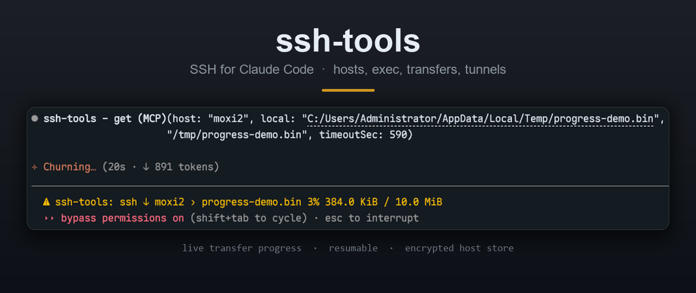

# claude-ssh-tools



**SSH for Claude Code** — hosts, commands, transfers, tunnels and background jobs, as one installable mod.

[简体中文](README.zh-CN.md) · [Plugin docs](ssh-tools/README.md)

## Install

```
/plugin install ssh-tools --marketplace moxisuki/claude-ssh-tools
```

Or add the marketplace first, then install by name:

```
/plugin marketplace add moxisuki/claude-ssh-tools
/plugin install ssh-tools@claude-ssh-tools
```

Requirements: **Node 18+** and Claude Code **2.1.318+**. The SSH helper ships pre-bundled, so there is
nothing to `npm install` — and nothing to publish to npm.

## What you get

| Tool | What it does |
|---|---|
| `list` | Hosts with scope (project / global / ssh-config), auth method, group |
| `host` | Save, remove or trust a host |
| `wizard` | Create a host: validates, asks where to save, keeps it out of git |
| `exec` | Run a command — one host, several in parallel, or a whole group; `pty`, `sudo` |
| `run` / `logs` / `kill` | Background jobs: start, follow output incrementally, stop |
| `read` | Read a remote file without downloading it |
| `put` / `get` | Multi-file upload and download, resumable, with live progress |
| `tunnel` | Local (`-L`), remote (`-R`) and dynamic SOCKS5 (`-D`) forwarding |
| `doctor` | Environment check: node, keystore, config files, pinned keys |

Slash commands: `/ssh` opens a pane with hosts, tunnels and jobs; `/ssh-doctor` runs the check.

## Hosts and secrets

| Scope | File | Committed |
|---|---|---|
| project | `.claude/ssh-hosts.local.json` | No — checked against `.gitignore` |
| global | `~/.claude/ssh-hosts.json` | Your call |
| ssh-config | `~/.ssh/config` | Read-only |

Project entries override global ones; a shadowed global entry is marked in `list`.
Passwords and passphrases are stored as references — DPAPI on Windows, Keychain on macOS, libsecret on
Linux — or as `env:`, `file:` or opt-in `cmd:`. Plaintext is encrypted before it reaches disk.

Authentication is ssh2 itself: password, key, agent and keyboard-interactive all work headless, with no
local `ssh` binary. Host keys are pinned on first connect and verified afterwards.

## Security

A mod that answers a tool call bypasses the engine's permission dialog, so ssh-tools asks
`$.tool.check` before every action, honours `deny`, and turns `ask` into a confirmation. Secrets travel
to the helper on stdin, never in argv or environment variables.

## Development

```bash
cd ssh-tools
npm install
npm run build        # bundle helper/src/index.mjs into helper/ssh-helper.cjs
npm run typecheck    # needs the types the engine lays at .claude-plugin/types
claude plugin validate .
claude plugin test .
```

## License

MIT
